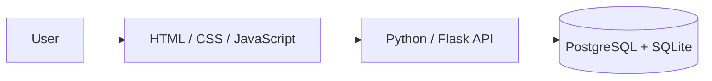

# A.I.M. — Action, Intention, Momentum

A.I.M. is a modern, Kanban-style task manager designed to transform personal goals and everyday responsibilities into manageable actions, support sustained focus, and encourage consistent progress toward meaningful completion. Developed with the assistance of AI-powered tools and agents.

**Live Demo -** [A.I.M](https://aim-ebz4.onrender.com/)

**Author:** Tosh · **Course:** CMP 464/343 Product 1 · **Last updated:** November 2, 2026

---

## 1. About Me (the User)

I am a student and aspiring developer with personal, academic, and professional goals that I work toward while managing the everyday responsibilities of life.

I often have a clear idea of what I want to accomplish each day and make plans to get there. However, putting those plans into action and staying consistent can be challenging. I sometimes reach the end of the day having completed far less than I intended, with important responsibilities and personal goals still waiting for my attention.

**The last 3 times this happened:**
1. Academic responsibilities: When I sit down at my computer to work on an assignment or complete a quiz, I sometimes get distracted by unrelated websites or browsing while taking breaks between tasks. What starts as a quick distraction can turn into a much longer period of wasted time. Before I realize it, I have lost focus, fallen behind on what I intended to accomplish, and have less time available to complete my coursework.

2. Personal responsibilities: Household chores and everyday responsibilities are sometimes put off to focus on other activities. I try to address them earlier but end up putting them off until the last minute, creating additional pressure and leaving less time for other priorities.

3. Project development: When working on personal software projects, I usually set milestones and outline the programming tasks I want to complete. However, when coursework and everyday responsibilities compete for my time, I sometimes struggle to maintain consistent progress. As a result, I fall behind on planned milestones and leave parts of my projects unfinished longer than I intended.


**What it costs me:**
- ⏱️ Time: Hours spent deciding what to do, reorganizing responsibilities, or postponing tasks instead of completing them.

- 💸 Money: Missed freelance or scholarship-application deadline.

- 🔋 Energy: Mental fatigue from keeping unfinished responsibilities in my head and feeling overwhelmed by competing expectations.

- 🙂 Joy: Frustration from not accomplishing what I planned, reduced satisfaction with my progress, and less time available for personal interests.

---

## 2. Problem Statement

**Gut check:**

Knowing what needs to be done does not always translate into following through. I need a consistent way to turn my goals and responsibilities into manageable actions, maintain focus, and make meaningful progress without becoming overwhelmed or burning out.

**Five Whys:**
1. Why do I struggle to complete responsibilities? Because I often have difficulty deciding what to work on and translating plans into action.
2. Why is deciding what to work on difficult? Because multiple responsibilities compete for my attention, making priorities unclear.
3. Why do competing responsibilities become overwhelming? Because larger goals and obligations are not always broken into smaller, clearly defined actions.
4. Why does that prevent consistent progress? Because without clear next steps and realistic expectations, beginning and maintaining momentum becomes difficult.
5. Why does this pattern continue? Because my current approach relies heavily on memory, informal planning, and manually reorganizing responsibilities rather than a consistent process for managing them.

**Problem statement:**

When balancing school, personal goals, and everyday responsibilities, I often struggle to decide what needs my attention and follow through on what I intend to accomplish. Even when I know what needs to get done, figuring out where to start and staying focused can be difficult.

As responsibilities pile up, it becomes harder to manage my time, maintain priorities, and make consistent progress. Larger goals can feel overwhelming, smaller tasks get pushed aside, and important responsibilities are left unfinished.

Having goals and knowing what needs to be done are not always enough to make meaningful progress. When I struggle to turn my intentions into consistent action, it often leads to frustration, mental fatigue, and delays in reaching goals.


**I'll know this is solved when:** 
I can consistently turn responsibilities and personal goals into manageable steps, understand what needs my attention, and make visible progress toward completion rather than allowing important tasks to remain unfinished or indefinitely postponed. 

---

## 3. Existing Solutions

| What I use or tried | What it does well | Why it falls short *for me* |
|---|---|---|
|**Whiteboard**| Gives a clear visual reminder of responsibilities; easy to update; helps externalize tasks.| Simply seeing tasks doesn't consistently translate into action. It offers little guidance on what to focus on next and doesn't help set realistic expectations for how much can be accomplished.|
|**Trello**|Organizes work into structured lists, keeps responsibilities centralized, and provides a clear overview of ongoing tasks.|A well-organized list still doesn't answer the question, "What should I work on right now?" It supports organization but not execution, prioritization, or realistic workload management.|
|**Mental reminders**|Helps me keep important commitments and responsibilities in mind without relying on external tools.|Relies heavily on memory and attention, making it unreliable when I'm distracted, busy, or focused on other priorities.|

**The gap:**

The existing approaches help me remember and organize responsibilities, but they do not consistently help me translate those responsibilities into manageable actions. What is missing is a clear connection between defining what I want to accomplish, identifying what needs to happen next, understanding my available time, and recognizing the progress I make.

---

## 4. Features & Benefits

| Feature (what it does) | Benefit (how my life gets better) | Status |
|---|---|---|
| **Goal Creation** — Create and define a goal or project with a title and description.| Provides a clear sense of direction and turns vague ideas into actionable objectives.| MVP|
| **Task Breakdown** — Break goals into smaller tasks with titles and optional descriptions. | Makes complex work feel manageable and provides a clear starting point.| MVP|
| **Kanban Workflow** — Organize tasks into New, Ready, In Progress, Review, and Done stages using a Kanban board.| Gives a visual view of current work and completed accomplishments. | MVP|
| **My Time** — Log work sessions, optionally link them to tasks, record downtime, and add task time estimates.| Helps build time awareness and set more realistic expectations for work.| Built beyond MVP |
| **Dashboard** — View project progress, task summaries, priorities, recommendations, and momentum.| Makes it easier to monitor progress and decide what needs attention.| Built beyond MVP |
| **Progress Analytics** — Analyze task completion trends, time allocation, and productivity patterns.| Provides insights into work habits and progress, helping users make data-informed improvements.| Later |

In the app, a goal is represented as a project, and its tasks are the steps toward completing it.

### MVP

* **Create a Goal:** Create and define goals or projects with a title and description.
* **Break It Down:** Divide goals into actionable tasks.
* **Manage Workflow:** Organize tasks in New, Ready, In Progress, Review, and Done statuses.
* **Project Details:** Open a project to see its description and tasks organized by status (New, Active, Complete).


### Built beyond the MVP

* Dashboard: View project progress, task summaries, priorities, recommendations, and momentum.
* My Time: Record focus sessions and downtime, and add time estimates to tasks.
* Edit & Delete: Update projects and tasks after creation, with deletion available through the edit experience.
* User Accounts: Sign up, log in, and access the a users projects and data

### Later

* Manual Task Priorities: Assign High, Medium, or Low priority levels to help users determine which responsibilities require attention first. The dashboard's current task ordering is derived from task status and update date, not user-assigned priority.
* Labels and Categorization: Organize tasks using customizable labels and categories for easier identification and filtering.
* Due Dates and Deadline Visibility: Assign deadlines to tasks and make upcoming or overdue responsibilities easier to recognize.
* Password Recovery: Allow users to securely recover access to their accounts if they forget their passwords.
* Progress Analytics and Insights: Provide visual summaries and insights into task completion, time allocation, and productivity patterns.
* Subtask Management: Allow users to create smaller tasks within larger tasks to support more detailed planning and execution.
* Interface Language and Consistency: Refine navigation labels, page titles, headings, descriptions, and instructional text to establish a consistent voice that reflects A.I.M.'s purpose, terminology, and product identity.

### Not Doing

* Real-time collaboration and team management.
* AI-generated task recommendations or planning.
* Email, SMS, or push notifications.
* Advanced permission and role management.
* Calendar and third-party productivity integrations.
* Productivity scoring.

---

## 5. Tech Stack

### Front end
- **Surface:** Web app (desktop and mobile-friendly) with a Kanban-style interface.
- **Tools:** HTML (Flask/Jinja templates), plain CSS, and vanilla JavaScript modules. No React or UI framework was used.
- **Why:** A web application provides an accessible environment for managing responsibilities from my computer without requiring a separate mobile application. Plain JavaScript modules kept the app small and free of a build step.

### Back end
| Piece | Choice | Why |
|---|---|---|
| Server / API | Python / Flask | Lightweight HTTP API for the MVP |
| Data storage | PostgreSQL when `DATABASE_URL` is set (via `psycopg`); local SQLite file (`aim.db`) otherwise | Persistent relational storage when deployed, zero-setup local development |
| Authentication | Flask sessions, signed with `SECRET_KEY` | Per-user projects and tasks |
| Outside services (optional) | None | |
| Hosting / deploy | Render (`render.yaml`, Gunicorn) | Simple public test instance |

### Run locally

Install GNU Make and Python, then run these commands from the repository root:

```bash
make install
make run
```

By default, local data is stored in `aim.db` using SQLite. To use another port, run `make run PORT=8000`.

### Architecture sketch



The Flask backend is organized as a Python package:

```text
app.py                    # Application entry point
backend/
├── __init__.py           # Flask application factory and configuration
├── database.py           # PostgreSQL/SQLite connection management and schema initialization
├── auth.py               # User registration, authentication, and session management
├── routes.py             # Main page, project, and task API endpoints
├── serializers.py        # Database-row to JSON conversion
├── dashboard.py          # Dashboard summaries and recommendations
├── focus.py              # Focus-time entries and available-time settings
├── downtime.py           # Downtime entries and categorization
└── dates.py              # Date and numeric parsing helpers
```

The browser code is organized as JavaScript modules:

```text
frontend/js/
├── main.js               # Application entry point, navigation, and initialization
├── config.js             # Shared application state, task statuses, and selections
├── api.js                # API communication, state management, and local file-mode storage
├── auth.js               # Login and registration interface
├── render.js             # Kanban board, project, task, and completion rendering
├── drag-drop.js          # Task drag-and-drop interactions
├── modals.js             # Project and task creation, editing, and deletion dialogs
├── dashboard.js          # Dashboard summaries, priorities, and progress visualization
├── focus.js              # Focus-time tracking interface
├── downtime.js           # Downtime tracking interface
└── utils.js              # Shared DOM, date, escaping, and action helpers
```

The CSS uses the same modular approach while keeping `styles.css` as the single
stylesheet entry point:

```text
frontend/css/
├── styles.css            # Main stylesheet entry point
├── base.css              # Design variables & global element defaults
├── layout.css            # Application shell, navigation, sidebar, and buttons
├── board.css             # Kanban columns, filters, and task cards
├── projects.css          # Project cards and project details
├── dashboard.css         # Dashboard layout and progress visualization
├── downtime.css          # Focus and downtime workspace styling
├── modals.css            # Dialogs and form controls
├── responsive.css        # Mobile and tablet layouts
└── auth.css              # Login and registration styling
```

The HTML is rendered as Flask/Jinja templates:

```text
templates/
├── index.html            # Main document and authentication routing
└── components/
    ├── app-shell.html    # Shared application layout and workspace composition
    ├── sidebar.html      # Branding, navigation, and momentum summary
    ├── topbar.html       # Workspace header
    ├── auth.html         # Login and registration interface
    ├── board-view.html   # Kanban board workspace
    ├── goals-view.html   # Goals and project overview
    ├── project-detail-view.html  # Individual project and task details
    ├── dashboard-view.html       # Intention, action, and momentum overview
    ├── focus-view.html           # Focus-time tracking interface
    ├── downtime-view.html        # Downtime tracking interface
    ├── modals.html       # Shared project and task dialogs
    └── empty-state.html  # Reusable empty-state content
```

---

## 6. Open Questions

*What am I still unsure about? What do I need to figure out or test first?*

- Will breaking larger responsibilities into smaller tasks make it easier to get started and reduce procrastination?

- What is the minimum information a task needs to be actionable without making task creation feel like extra work, and would adding subtasks make it easier to break larger responsibilities into manageable steps?

- Should due dates be included in the initial MVP, or can the basic Kanban workflow provide enough value on its own?

- How can A.I.M. help me identify which task to work on next without adding unnecessary complexity?

- How can I determine whether A.I.M. actually improves follow-through rather than becoming another place to organize unfinished responsibilities?

- What should productivity insights measure, and how can they provide meaningful information about my progress?

- Would a mobile application meaningfully improve accessibility and consistent use, or should development initially focus on the desktop experience?

- Should the application collect personal information, such as an email address, during account registration?

*What I Need to Test First*
- **Goal-to-task workflow:** Is the process of creating a goal, breaking it into smaller tasks, and managing those tasks simple enough to use consistently?

- **Kanban workflow:** Does the board make it easier to understand task status and identify the next actionable task?

- **Problem validation:** Does the implemented workflow address the original intention-to-action problem rather than simply recreating a digital planner?

- **Data reliability:** Are goals, tasks, and progress saved and retrieved reliably?

- **Time tracking:** Can working time and downtime be recorded accurately without errors or interruptions?

- **User experience:** Is the interface intuitive, easy to navigate, and straightforward to use without creating additional mental effort?
